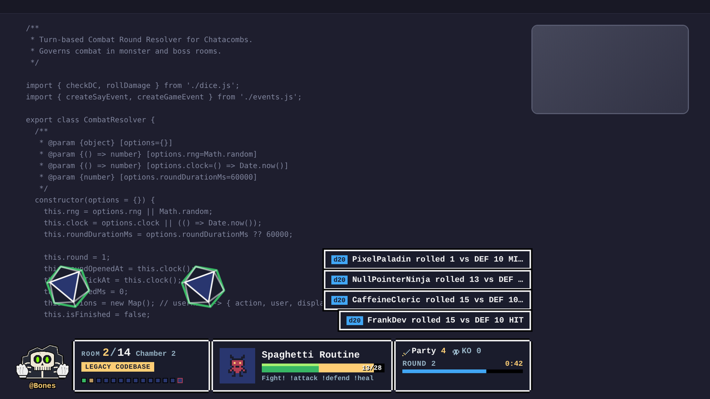
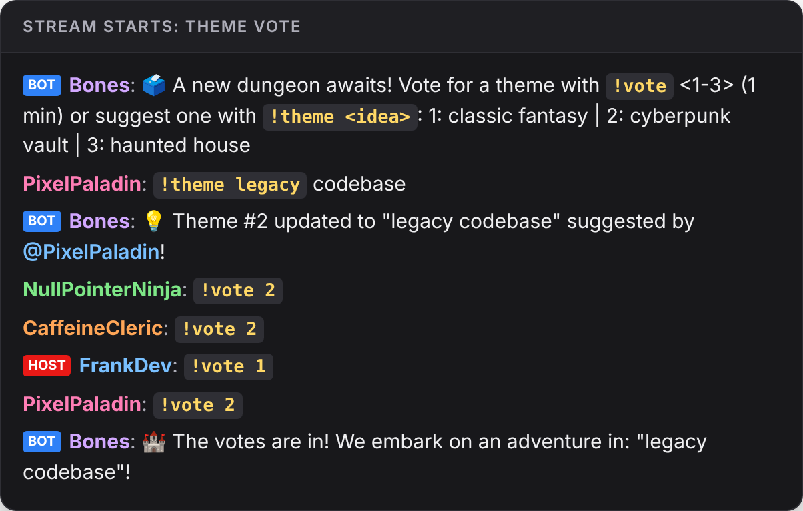
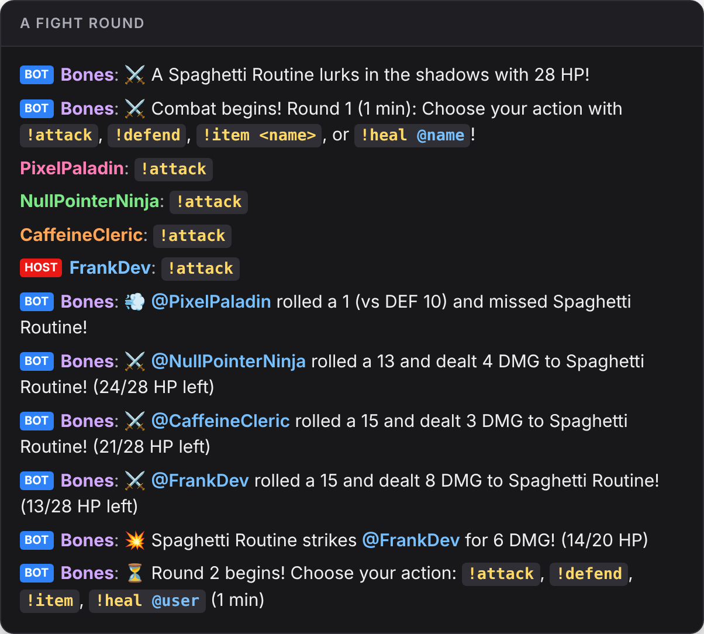
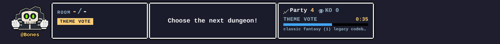
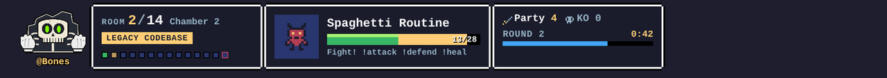
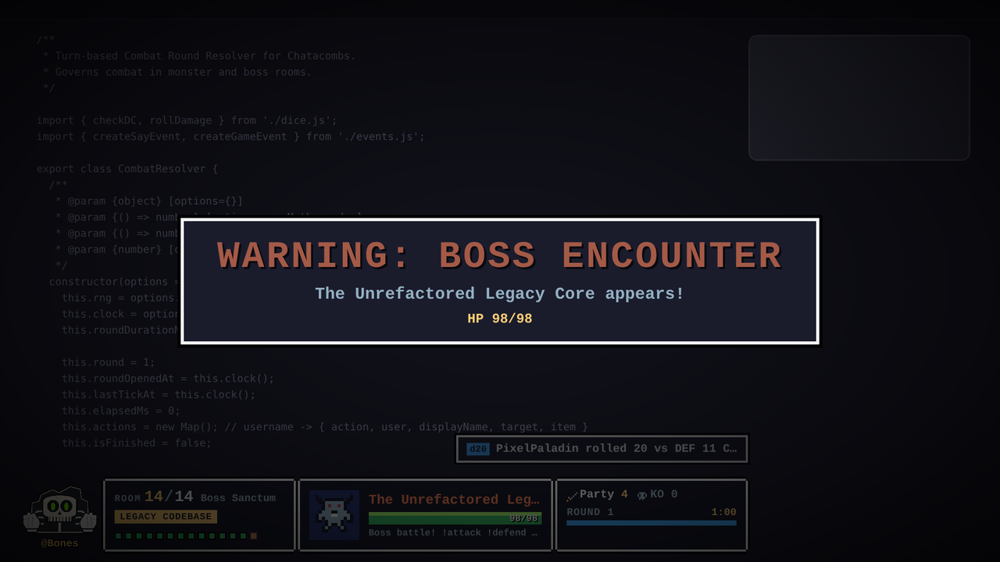
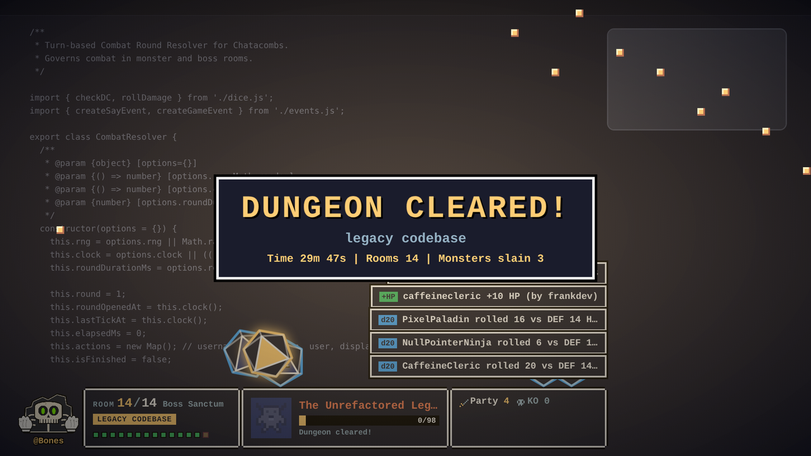

# 🏰 Chatacombs

**A dungeon crawler your stream chat plays on its own while you stream.**

Every viewer who chats joins the party. Your chat bot becomes the dungeon master, describing rooms, rolling dice and calling out every hit. Viewers vote on where to go, fight monsters together and heal each other, all with chat commands, and an OBS overlay puts the big moments on screen. You don't need to run anything: the game runs itself, and you're just another player.



## What it looks like

A real game, captured from the service (the "legacy codebase" theme was suggested by chat):

<table>
<tr>
<td width="50%"></td>
<td width="50%"></td>
</tr>
<tr>
<td><b>Chat picks the dungeon.</b> Bones offers three themes, viewers vote or suggest their own with <code>!theme</code>.</td>
<td><b>Everyone fights together.</b> One action per player per round, then the dice decide.</td>
</tr>
</table>

The overlay follows along at the bottom of the stream, and the big moments take over the screen:




<table>
<tr>
<td width="50%"></td>
<td width="50%"></td>
</tr>
</table>

## How a game goes

1. **Theme vote.** When the stream starts, chat votes on a theme: `!vote 2` or `!theme pirate ship`.
2. **Explore.** The party walks through 10 to 15 rooms. `!explore` searches for treasure (and traps), and `!go north` votes on the way forward.
3. **Fight.** Monsters fight in one-minute rounds: `!attack`, `!defend`, `!heal @friend`.
4. **Beat the boss.** The last room holds the boss. XP and gold are shared by everyone present and carry over to the next stream.

Chat can also ask the dungeon master anything with `@Bones`. With an AI endpoint configured, those answers and the room descriptions are written by a model, while the game code alone decides HP, dice and loot.

## Documentation

| Guide | For |
| --- | --- |
| 🎮 **[Player guide](docs/players.md)** | Viewers: every command, how fights and rewards work, tips, and chat examples |
| 📺 **[Streamer guide](docs/streamers.md)** | The person hosting: running the container, OBS setup, connecting your bot, configuration, backups and troubleshooting |
| 🤖 **[Bot adapter example](docs/adapter-example.md)** | Bot developers: a complete adapter in under 40 lines of Node.js, plus Python |
| 📐 [PLAN.md](PLAN.md) | Architecture, database schema and the full HTTP/SSE API |
| 📜 [Game design](chat-dungeon-crawler-design.md) | The rules and why they are the way they are |

## Quick start

You need Docker.

```bash
git clone https://github.com/fboucher/chatacombs.git
cd chatacombs
cp .env.example .env              # set your own API_KEY and OVERLAY_KEY
docker compose up -d --build
curl http://localhost:8080/health # {"status":"ok","service":"chatacombs"}
```

Then:

1. **OBS:** add a Browser source (1920×1080) pointing at `http://localhost:8080/overlay/{channel}?key={OVERLAY_KEY}`.
2. **Bot:** forward chat to `POST /api/v1/channels/{channel}/messages` and post the `say` events from `GET /api/v1/channels/{channel}/events` back to chat. See the [adapter example](docs/adapter-example.md).
3. **No bot yet?** Play from a terminal: `API_KEY=... CHANNEL=yourchannel node examples/bot-adapter.js`, then type `/start` and `alice: !vote 1`.

The [streamer guide](docs/streamers.md) walks through each step, including `docker run` without Compose and every configuration option.

## Configuration

| Variable | Purpose | Default |
| --- | --- | --- |
| `API_KEY` | Secret for your **chat bot**: sent as `Authorization: Bearer` on every `/api/v1` call. Lets it play and start/end adventures. | `dev-secret-key` |
| `OVERLAY_KEY` | Separate, watch-only key for **OBS**: goes in the overlay URL (`?key=`). Can't change the game. | `dev-overlay-key` |
| `AI_URL` / `AI_KEY` / `AI_MODEL` | Optional OpenAI-compatible endpoint for narration. For a model on your computer, use `http://host.docker.internal:<port>/v1`, not `localhost` (inside the container, localhost is the container). | empty (built-in text) |
| `AI_TIMEOUT_MS` | How long to wait for the AI before falling back to built-in text | `10000` |
| `BOT_NAME` | The name viewers `@mention` | `Bones` |
| `HELP_URL` | Link posted when chat asks "Bones help" | the player guide on GitHub |
| `PORT` | Listening port | `8080` |
| `DATABASE_PATH` | SQLite file | `/data/chatacombs.db` in Docker |

Change both keys before going live, and use two different values. The [streamer guide](docs/streamers.md#which-key-goes-where) explains which key goes where and [how the container reaches services on your computer](docs/streamers.md#reaching-services-on-your-computer-from-the-container).

## Development

Requires Node.js 22 or newer.

```bash
npm install
npm start            # service on http://localhost:8080
npm test             # node --test suite
npm run simulate     # interactive terminal simulator
```

Stack: Node.js, Express, SQLite (`better-sqlite3`), Server-Sent Events and a dependency-free overlay page. The rules engine is deterministic and fully tested offline; AI only ever adds flavour text.
