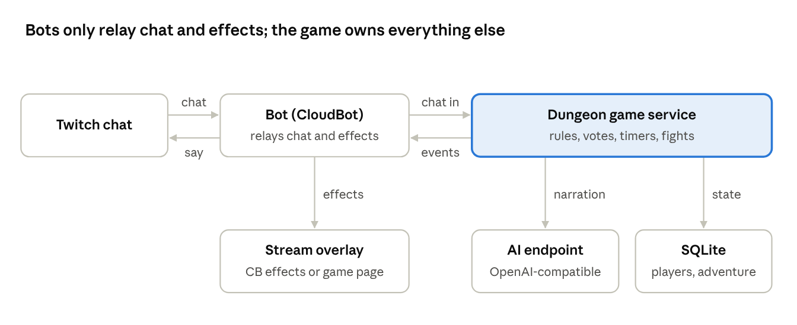

# Chat Dungeon Crawler: Design

Oct 10, 2026 · Frank Boucher

## Overview

A standalone chat dungeon crawler that runs in a streamer's Twitch chat on its own while they work. Every active viewer is in the party, and the game acts as dungeon master through whatever chatbot the streamer already runs. CloudBot (CB) is the first bot to use it.

Decisions agreed with Frank on 2026-10-10:

- **Standalone service in its own repo.** It is a Docker image with an HTTP API, and bots are clients of it. CloudBot keeps none of the game logic.
- **Code owns the truth, AI narrates.** Code tracks rooms, monsters, HP, items and who is alive. The AI describes rooms and answers viewers' free-text questions. It never decides outcomes.
- **Fully autonomous.** The streamer is just another player and never has to run the game.
- **Mostly chat.** About 80 to 90% of the game happens in chat. Key moments trigger on-screen overlays to pull more viewers in.
- **Simple v1.** Everyone plays the same hero type, and the only help action is `!heal`.

## Gameplay

An adventure is one dungeon of 10 to 15 rooms. It ends when the party clears the last room, everyone is knocked out, or the stream ends, whichever comes first.

1. **Theme vote.** The game offers 3 themes: classic fantasy plus 2 random ones from a built-in list (sky castle, haunted house, legacy codebase, pirate ship…). During the one-minute vote, viewers can suggest their own with `!theme haunted house`. The first two suggestions replace the random slots. No votes means classic fantasy.
2. **Generate the dungeon.** Code builds the map (rooms, exits, monsters, loot, a boss in the last room) from the theme. The AI only adds names and descriptions.
3. **Enter a room.** CB describes it in 2 Twitch messages at most. Viewers can ask `@CB` free-text questions about it and search it.
4. **Move on.** The first `!go <exit>` opens a one-minute vote, and the majority wins. Ties go to the first exit voted for.
5. **Fight.** A fight runs in one-minute rounds. Every present player gets one action per round (attack, defend, use an item, or `!heal @name`). The round resolves all at once with dice rolls, then the monster strikes back.
6. **Repeat** until the adventure ends. The next theme vote starts on its own about 15 minutes later, or at the start of the next stream.

**Party.** Anyone who chatted in the last 15 minutes is in the party automatically. Monsters only target present players, so viewers who leave never die in their sleep.

**Knocked out.** A player at 0 HP sits out until the party reaches the next room, then comes back with low HP.

**Pacing.** Nothing happens while chat is quiet. CB nudges the party at most once every 10 minutes. CB posts at most one message per vote window, so it never floods the streamer's chat.

**What carries over.** Level, XP and gold stay with each viewer across adventures, and `!hero` shows them. HP and dungeon items reset with each new adventure.

## Content model

Code owns every fact, and the AI only turns facts into words, so it can never invent an exit, revive a monster or forget someone's HP.

| Layer | Owned by | Examples |
| --- | --- | --- |
| Dungeon structure | Code, generated per adventure from theme templates | Room count, exits, room type (empty, treasure, trap, monster, boss) |
| Rules and numbers | Code | HP, damage, dice, loot tables, XP, vote timers |
| Flavour | AI, given the facts as context | Room descriptions, monster names, answers to `@CB` questions, fight narration |
| Free-text intent | AI, mapped to a fixed list of actions | "I kick the chest" becomes the open action on the chest, or a flavour answer only |

- Every AI call gets the current room state as structured context and must stay inside it.
- If the AI endpoint fails or is slow, the game falls back to short template text and keeps going.
- Descriptions are generated once per room and stored, so the same room reads the same when chat asks again.

## Commands

CB already uses `!search`, `!use`, `!bag`, `!dice`, `!roll`, `!stats`, `!rpg`, `!start` and `!stop`, so the dungeon uses different words. The game ignores anything it doesn't know, which means a bot can forward all chat safely.

| Command | When | What it does |
| --- | --- | --- |
| `!vote 2` | Theme vote | Votes for a theme by its number |
| `!theme <idea>` | Theme vote | Suggests a theme, for example `!theme haunted house` |
| `@CB <question>` | Any time | Free-text question or action, answered in character |
| `!explore` | In a room | Searches the room for loot, traps or secrets |
| `!go <exit>` | In a room | Votes for an exit. The first vote opens a one-minute window |
| `!attack` | Fight round | Attacks the monster |
| `!defend` | Fight round | Takes less damage this round |
| `!item <name>` | Fight or room | Uses a dungeon item, for example `!item potion` |
| `!heal @name` | Fight or room | Heals another player with one of your potions |
| `!hero` | Any time | Shows your HP, level, XP, gold and items |

The bot's own name (`@CB`) and every command word are settings, so another streamer can rename them to fit their bot.

## Architecture and API

The game is one Node service, so a bot needs only two calls: post chat in, and listen to an event stream out. The event stream is needed because much of the game runs on timers, such as votes closing, fight rounds resolving and nudges, not only in reply to a message.



Chat flows in through the bot, and the game answers with text to post and moments to show on the overlay.

Stack: Node, Express, SQLite and Docker, the same as CloudBot. The AI is any OpenAI-compatible chat completions endpoint.

| Call | Purpose |
| --- | --- |
| `POST /api/v1/channels/{channel}/messages` | The bot forwards every chat line: `{user, displayName, text, isBroadcaster}`. Returns 202 right away |
| `POST /api/v1/channels/{channel}/stream` | `{state: "started" or "ended"}`. Ending the stream ends the adventure. With no call, 60 quiet minutes count as ended |
| `GET /api/v1/channels/{channel}/events` | Server-sent events: `say` (text to post in chat) and `game` (a moment, see below) |
| `GET /api/v1/channels/{channel}/state` | Snapshot of the theme, room, party HP and votes, for overlays and debugging |
| `GET /overlay/{channel}` | Built-in overlay page for OBS, for streamers whose bot has none |

Game moments are generic, so each bot maps them to its own effects: `adventure_started`, `room_entered`, `dice_roll`, `player_healed`, `rare_loot`, `boss_appears`, `monster_defeated`, `player_knocked_out`, `party_wiped`, `dungeon_cleared`. Each carries the players and values involved, such as `{type: "player_healed", user, target, amount}`.

Every API call needs `Authorization: Bearer <API key>`. The overlay page uses a separate read-only key in its URL. The `{channel}` segment means one instance could later host several streamers, but v1 assumes one instance per streamer.

## Running your own instance

Another streamer runs one container, points their bot at it and adds the overlay to OBS. There are no accounts and no hosting costs for Frank.

```bash
docker run -d -p 8080:8080 -v dungeon-data:/data \
  -e AI_URL=https://their-endpoint/v1 -e AI_MODEL=their-model -e AI_KEY=... \
  -e API_KEY=secret-for-the-bot -e OVERLAY_KEY=secret-for-obs \
  -e BOT_NAME=CB \
  <image>
```

- **AI settings** work like CloudBot's AI connections: any OpenAI-compatible endpoint (local or hosted), model and key.
- **`/data`** holds the SQLite file, which stores players, levels, XP, gold and the current adventure.
- **Their bot** needs a small adapter: forward chat, subscribe to the events, post the `say` text and optionally map `game` moments to effects. The repo ships a documented example adapter.
- **No customizable bot?** The game reading Twitch chat itself is out of scope for v1.

## CloudBot integration

One small CloudBot PR (a branch off `dev`, targeting `dev`) makes CB the first client, and CB's own loot game stays as it is.

- **Chat in.** The overlay page already posts every chat line to `/api/chat-event`. That handler also forwards the line to the game.
- **Events out.** The CB server subscribes to the game's event stream and relays each event through its existing overlay stream (`broadcastSSE`).
- **Speaking.** The overlay page posts `say` text with `ComfyJS.Say`, the same way CB talks today.
- **Stream state.** CB's existing stream start and stop calls tell the game when the stream starts and ends.
- **Settings.** The admin page gets a Dungeon section with the game URL, API key and an on/off switch.

Game moments map to effects CB already has:

| Game moment | CB effect |
| --- | --- |
| `player_healed` | Potion effect with the "+HP" banner |
| `dice_roll` | Dice roll overlay |
| `rare_loot` | CB Wow reaction |
| `monster_defeated` | CB Tada reaction plus applause |
| `boss_appears` | Thunderstorm |
| `dungeon_cleared` | Rainbow sunshine plus "yeah" |

Other moments stay in chat only.

## Defaults, scope and first steps

Frank didn't weigh in on these, so I picked defaults. Each one is easy to change.

- Fights run in one-minute rounds with one action per player.
- The party is anyone who chatted in the last 15 minutes.
- Level, XP and gold carry over, and HP and dungeon items reset.
- The next adventure starts about 15 minutes after the last one ends, or at the next stream.
- Dungeon command words avoid all of CB's existing commands.

**Out of scope for v1:** classes, revive and protect actions, the game reading Twitch chat directly, a shared hosted service, and dungeons that span several streams.

**Build order in the new repo:**

- [ ] Engine core: generate the dungeon, room state, votes and fight rounds, tested without AI or chat
- [ ] HTTP API, event stream, API keys and SQLite storage
- [ ] AI narration with template fallback, plus the theme vote and suggestions
- [ ] Built-in OBS overlay page, Dockerfile and a README for other streamers
- [ ] CloudBot adapter PR on a branch off `dev`, using the mapping above
