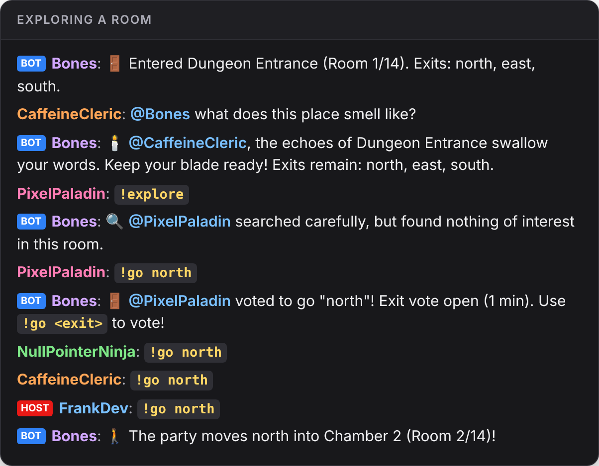
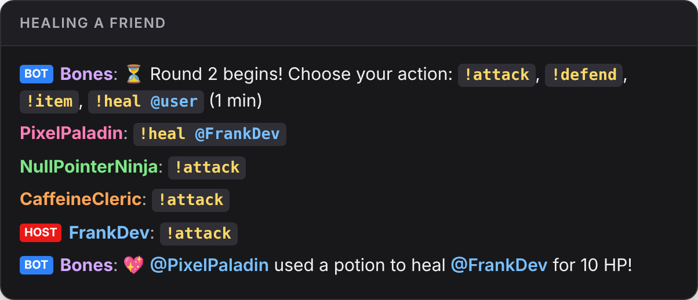
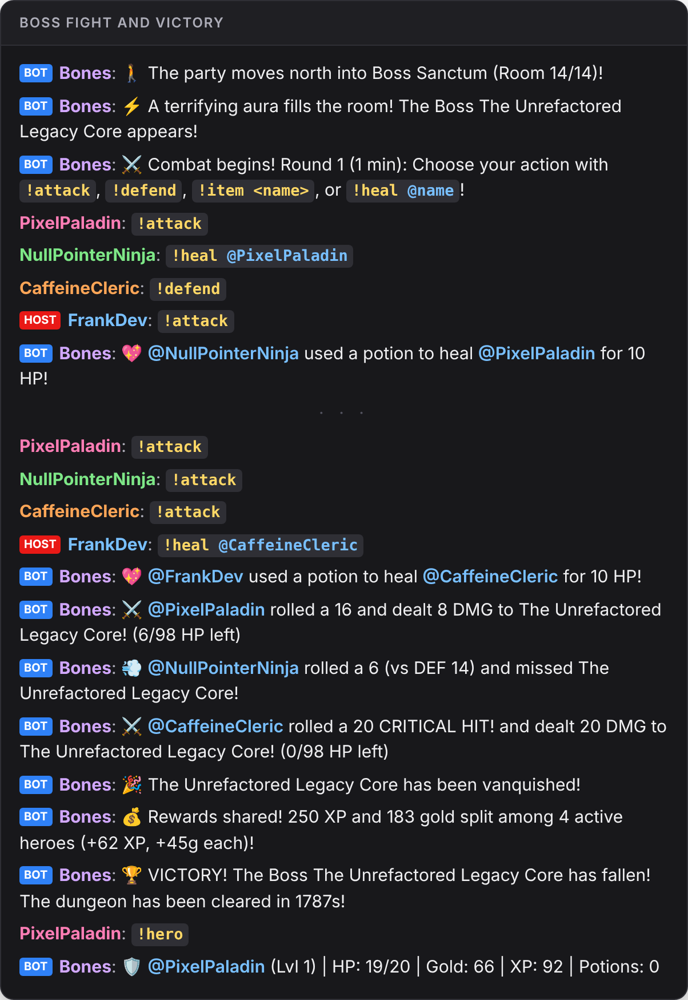

# Player guide

Chatacombs is a dungeon crawler you play from the stream chat. Everyone who chats is in the party, the bot (called **Bones** here) is the dungeon master, and the stream shows the big moments on screen. You don't need to sign up or install anything. Just type.

## The 30-second version

1. When a new dungeon starts, vote for a theme with `!vote 1`, `!vote 2` or `!vote 3`.
2. In each room, search it with `!explore`, then pick a way out with `!go north` (or whatever exits Bones lists).
3. When a monster shows up, everyone picks one action per round: `!attack`, `!defend`, or `!heal @friend`.
4. Beat the boss in the last room. Gold and XP stay with you for the next adventure.

## Joining the party

You're in the party as soon as you chat. Anyone who has said anything in the last 15 minutes counts as present. Monsters only attack players who are present, so if you step away you won't get knocked out while you're gone.

## Commands

| Command | When | What it does |
| --- | --- | --- |
| `!vote 2` | Theme vote | Votes for a theme by its number |
| `!theme <idea>` | Theme vote | Suggests your own theme, e.g. `!theme pirate ship` |
| `!explore` | In a room | Searches the room for loot, traps or secrets |
| `!go <exit>` | In a room | Votes for an exit, e.g. `!go north` |
| `!attack` | Fight round | Rolls a d20 to hit the monster |
| `!defend` | Fight round | Halves the damage if the monster hits you this round |
| `!item <name>` | Fight or room | Uses an item, e.g. `!item potion` |
| `!heal @name` | Fight or room | Gives one of your potions to a friend |
| `!hero` | Any time | Shows your HP, level, XP, gold and potions |
| `@Bones <question>` | Any time | Ask the dungeon master anything, in character |
| `Bones help` | Any time | Lists the commands with a link to this guide. `Bones how do I play?`, `Bones commands`, `Bones doc` and `Bones ?` work too. Answered once every 5 minutes for the whole chat. |

Anything that isn't a command is just normal chat, so talk as much as you like. The bot may have a different name on your streamer's channel; ask with `@` and its name.

## How an adventure goes

### 1. Theme vote

When the stream starts, Bones offers three themes. The vote lasts one minute. Suggest your own with `!theme`: the first two suggestions replace the random choices. If nobody votes, the party goes with classic fantasy.

The overlay shows the vote and its countdown at the bottom of the stream:

### 2. Exploring rooms

A dungeon has 10 to 15 rooms. Bones describes each one and lists its exits. Type `!explore` to search for treasure, but be careful: some rooms hide traps. A good roll spots the trap and disarms it; a bad one hurts the whole party.

The first `!go <exit>` opens a one-minute exit vote. The exit with the most votes wins, and a tie goes to the exit that was voted for first.

### 3. Fights

When the party walks into a monster's room, a fight starts. Fights run in one-minute rounds, and every present player gets **one action per round**. When the timer runs out, everything resolves at once:

- Each `!attack` rolls a d20 against the monster's defence (DEF). Meet or beat it to hit; a natural 20 is a critical hit for big damage.
- Then the monster strikes back at one present player. If that player chose `!defend`, the damage is halved.

The overlay shows the monster's HP, the round timer, and a pop-up for every dice roll:

### 4. Helping each other

Everyone starts each adventure with **20 HP** and **one potion**, and you can find more potions while exploring. Use `!item potion` on yourself, or `!heal @name` to give a potion to a friend who is in trouble. A potion heals 10 HP.

If your HP reaches 0 you are **knocked out** and sit out the rest of that room. When the party moves to the next room you get back up with a little HP (25% of your max, at least 5). If everyone in the party is knocked out in a fight, the party is wiped and the adventure ends.

### 5. The boss

The last room always holds the boss. The stream shows a warning when it appears:

Boss fights are long, so take turns healing. Beat it and the whole stream celebrates:

## Rewards and levels

Every monster defeated and every treasure looted gives XP and gold, **split equally** between everyone present. You don't have to land the final blow to get your share.

Your level, XP and gold stay with you between adventures and streams. HP and potions reset at the start of each adventure. Check your progress any time with `!hero`.

| Level | Total XP needed |
| --- | --- |
| 2 | 100 |
| 3 | 250 |
| 4 | 450 |
| 5 | 700 |
| 6 | 1,000 |

Each level after that needs 50 XP more than the step before.

## Tips

- **Chat to stay in the party.** Even a quick hello keeps you present for 15 minutes.
- **Explore before you leave.** Most treasure (and potions) come from `!explore`.
- **Watch your friends' HP.** A `!heal` at the right moment is worth more than an `!attack`.
- **Defend when you're low.** Half damage can be the difference between standing and knocked out.
- **Ask Bones things.** `@Bones is that chest trapped?` gets an answer in character. Bones never changes the facts of the game, so its answers won't trick you.
- **Quiet chat pauses the game.** Timers only run while people are talking, so nobody loses a fight while chat is away.
