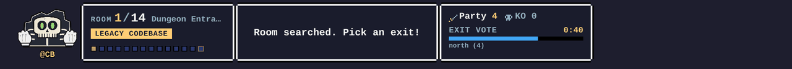
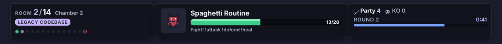

# Streamer guide

This guide is for the person hosting the game: running Chatacombs, adding the overlay to OBS and connecting your chat bot. Once it's set up the game runs itself. You never have to act as game master; you're just another player.


## How it fits together

```
Stream chat ──> your bot ──POST /messages──> Chatacombs ──say / game events──> your bot ──> Stream chat
                                                  │
                                                  └── /overlay/{channel} ──> OBS Browser Source
```

- **Chatacombs** is one small Docker container. It holds the rules, dice, monsters and everyone's progress (in a SQLite file).
- **Your bot** (CloudBot, or anything that can make HTTP calls) forwards chat to it and posts back whatever it says.
- **The overlay** is a web page Chatacombs serves for an OBS Browser Source. It shows the current room, votes, fights and the big moments.

## 1. Run the container

You need [Docker](https://docs.docker.com/get-docker/) (Docker Desktop on Windows or macOS).

### With Docker Compose (recommended)

```bash
git clone https://github.com/fboucher/chatacombs.git
cd chatacombs
cp .env.example .env        # on Windows: copy .env.example .env
```

Open `.env` and set two secrets of your own:

```ini
API_KEY=pick-a-long-random-string-for-your-bot
OVERLAY_KEY=a-different-random-string-for-obs
```

### Which key goes where

Chatacombs has two keys because two different things connect to it, and they need different access.

| | `API_KEY` | `OVERLAY_KEY` |
| --- | --- | --- |
| Who uses it | Your chat bot (CloudBot, the example adapter, Streamer.bot, ...) | OBS, in the overlay's Browser Source URL |
| How it's sent | Header `Authorization: Bearer <API_KEY>` | In the URL: `/overlay/{channel}?key=<OVERLAY_KEY>` |
| What it allows | Everything that changes the game: sending chat, starting and ending the stream, reading the bot event stream | Watching only: the overlay page, its snapshot and its event stream |
| If it leaks | Anyone could play as your chat or end your adventure. Change it. | Anyone could watch your overlay. Annoying, not harmful. |

Use two different random values. The overlay key ends up in OBS scene files and screenshots of your settings, so it must never be the same as `API_KEY`.

Then start it:

```bash
docker compose up -d --build
```

[`docker-compose.yml`](../docker-compose.yml) publishes port 8080, keeps the database on a named volume called `dungeon-data`, and restarts the container after a reboot.

### With plain `docker run`

```bash
docker build -t chatacombs .
docker run -d --name chatacombs --restart unless-stopped \
  -p 8080:8080 \
  -v dungeon-data:/data \
  -e API_KEY=pick-a-long-random-string-for-your-bot \
  -e OVERLAY_KEY=a-different-random-string-for-obs \
  chatacombs
```

### Check it's running

```bash
curl http://localhost:8080/health
# {"status":"ok","service":"chatacombs"}
```

On Windows PowerShell use `curl.exe`. You can also open `http://localhost:8080/health` in a browser. `docker ps` shows the container as `(healthy)` after a few seconds.

### Reaching services on your computer from the container

Inside the container, `localhost` means the container itself, not your computer. When Chatacombs needs something running on your computer, such as a local AI model (Ollama, LM Studio) for `AI_URL`, use **`host.docker.internal`** instead of `localhost`:

```ini
# Ollama on your computer, Chatacombs in Docker
AI_URL=http://host.docker.internal:11434/v1
AI_MODEL=llama3.2

# LM Studio on your computer
AI_URL=http://host.docker.internal:1234/v1
```

Docker Desktop (Windows, macOS) provides `host.docker.internal` out of the box, and `docker-compose.yml` maps it on Linux too. With plain `docker run` on Linux, add `--add-host=host.docker.internal:host-gateway`. The local AI server also has to accept connections from Docker: Ollama listens only on `127.0.0.1` unless you set `OLLAMA_HOST=0.0.0.0`.

Going the other way, your bot and OBS run on your computer, so they keep using `http://localhost:8080`. If your bot also runs in Docker, put both containers on the same Compose network and use `http://chatacombs:8080`, or use `http://host.docker.internal:8080` from the bot's container.

The startup log says whether AI narration is on and where it points: `docker compose logs chatacombs` shows a line like `🤖 AI narration: on (llama3.2 at http://host.docker.internal:11434/v1/chat/completions, 10000ms timeout)`.

## 2. Add the overlay to OBS

1. In OBS, add a **Browser** source to your scene.
2. Set the URL, replacing `{channel}` with your channel name and `{OVERLAY_KEY}` with the key from your `.env`:

   ```
   http://localhost:8080/overlay/{channel}?key={OVERLAY_KEY}
   ```

3. Set **Width 1920** and **Height 1080**, and put the source on top of your other sources. The background is transparent.

The overlay is a ribbon along the bottom of the screen. It covers three quarters of the width and leaves the bottom-right corner free for your webcam, with the bot's picture and `@BOT_NAME` at the other end:





Big moments take over the middle of the screen for a few seconds, and dice rolls pop up above the ribbon's webcam-side end:


### Overlay options

Add these to the end of the URL, e.g. `...?key=abc123&audio=1&theme=dark`.

| Option | Values | Default | What it does |
| --- | --- | --- | --- |
| `key` | your `OVERLAY_KEY` | (required) | Read-only key, safe to put in OBS |
| `audio` | `1` / `0` | `0` | Retro 8-bit sound effects. Off by default so nothing surprises you live. Tick **Control audio via OBS** on the source to mix it. |
| `theme` | `retro` / `dark` | `retro` | Pixel RPG look, or a darker modern look |
| `scale` | `0.8` to `1.2` | `1` | Ribbon size. Try `0.8` for a 720p canvas and `1.2` for 1440p. |
| `cam` | `right` / `left` | `right` | Bottom corner kept free for your webcam. The bot picture sits in the opposite corner. |
| `bot` | `skeleton` / `mummy` | `skeleton` | Which bot picture to show. Its label is `@` plus `BOT_NAME` from your `.env` (restart to change it). |

The `dark` theme:



## 3. Connect your bot

Your bot does three things. Every call needs the header `Authorization: Bearer <API_KEY>` (the bot key, never the overlay key).

1. **Forward every chat message** to `POST /api/v1/channels/{channel}/messages`:

   ```json
   { "user": "viewerkid", "displayName": "ViewerKid", "text": "!attack", "isBroadcaster": false }
   ```

   Send everything, not just commands: normal chat keeps viewers in the party, and `@CB` questions get an answer. Chatacombs ignores anything it doesn't understand.

2. **Listen to the event stream** at `GET /api/v1/channels/{channel}/events` (Server-Sent Events). Each event's `data:` is JSON:
   - `"kind": "say"` has a `text` line. **Post it to chat exactly as is.** Chatacombs already spaces these out (about one every 1.8 seconds), so your bot never floods chat.
   - `"kind": "game"` has a `type` such as `dice_roll`, `boss_appears`, `monster_defeated`, `dungeon_cleared` or `party_wiped`. Use them to trigger your bot's own sounds or effects, or ignore them.

3. **Say when you go live and when you stop** with `POST /api/v1/channels/{channel}/stream` and `{ "state": "started" }` or `{ "state": "ended" }`. Starting opens a theme vote; ending wraps up the current adventure.

**[docs/adapter-example.md](adapter-example.md)** has a complete adapter in under 40 lines of Node.js (plus a Python version) that you can copy into your bot, and a runnable copy you can try before touching your bot.

### Test without a bot

With the container running, the example adapter lets you play from a terminal:

```bash
API_KEY=your-api-key CHANNEL=yourchannel node examples/bot-adapter.js
```

Type `/start`, then chat as different viewers, e.g. `alice: !vote 1`, `bob: !theme pirate ship`, `alice: !explore`. Lines starting with `[bot]` are what your bot would post to chat. Keep the overlay open in a browser to watch it react.

## 4. Going live

Once the bot is connected there is nothing else to do:

- When your bot calls `stream` with `started`, CB opens a theme vote in chat.
- Viewers play. Timers only run while chat is active, and CB nudges the party at most once every 10 minutes when things go quiet.
- When you end the stream, your bot calls `stream` with `ended` and the adventure wraps up. Player levels, XP and gold are saved for next time.
- If your bot never sends `ended`, an adventure with 60 quiet minutes in chat is abandoned on its own.

Here is what a theme vote looks like in chat, with real output from the game:


Share the [player guide](players.md) with your community, e.g. in a `!dungeon` command or a panel.

## Configuration reference

| Variable | Purpose | Default |
| --- | --- | --- |
| `API_KEY` | Bearer token your bot sends on every `/api/v1` call. **Change it.** | `dev-secret-key` |
| `OVERLAY_KEY` | Read-only key for the OBS overlay URL. **Change it.** | `dev-overlay-key` |
| `AI_URL` | OpenAI-compatible endpoint for narration, e.g. `https://api.openai.com/v1`, or `http://host.docker.internal:11434/v1` for a model on your computer ([why not localhost](#reaching-services-on-your-computer-from-the-container)). `/chat/completions` is added if missing. Leave empty for built-in text. | empty |
| `AI_KEY` | API key for `AI_URL` | empty |
| `AI_MODEL` | Model name to use with `AI_URL` | empty |
| `AI_TIMEOUT_MS` | How long to wait for the AI before using built-in text. Raise it for a slow local model. | `10000` |
| `BOT_NAME` | The name viewers `@mention` to talk to the dungeon master | `CB` |
| `PORT` | Port the service listens on | `8080` |
| `DATABASE_PATH` | SQLite file location | `/data/chatacombs.db` in Docker, `./data/chatacombs.db` with `npm start` |

The `API_KEY` and `OVERLAY_KEY` defaults exist only so the service works out of the box for local testing. Always set your own before going live.

### AI narration (optional)

Without AI settings, CB uses built-in template text, and the game is fully playable. With `AI_URL`, `AI_KEY` and `AI_MODEL` set, the model writes answers to `@CB` questions and adds one line of flavour after the usual facts line when the party enters a room, meets a monster or ends a fight. The AI only describes what the game code decided: it can't change HP, dice or loot. If the endpoint is slow or down, the game falls back to the templates and keeps going, and the container log says why (at most once a minute): `docker compose logs -f chatacombs`.

## Looking after your data

Everything lives in the `dungeon-data` volume.

- **Back up:** `docker run --rm -v dungeon-data:/data -v "$PWD":/backup alpine tar czf /backup/dungeon-data.tgz -C /data .`
- **Update:** `git pull`, then `docker compose up -d --build`. The volume is kept.
- **Start fresh:** `docker compose down -v` deletes the volume and every player's progress.

## Troubleshooting

| Symptom | Check |
| --- | --- |
| Overlay page shows `Unauthorized` | The `key=` in the OBS URL must match `OVERLAY_KEY` exactly. |
| Bot gets `401` | The bot must send `Authorization: Bearer <API_KEY>` with the same value as the container. |
| Overlay is blank | It stays mostly empty until a game starts. Have your bot send `stream` `started`, or use the test adapter. |
| `@CB` always answers "the echoes of ... swallow your words" | That is the built-in text, so the AI isn't being reached. Check the log for an `[ai]` line. The usual cause is `AI_URL` pointing at `localhost` from inside Docker: use `host.docker.internal` ([details](#reaching-services-on-your-computer-from-the-container)). |
| CB never answers in chat | Your bot must be listening to `/events` and posting `say` lines. Run the example adapter to confirm the server side works. |
| Port 8080 is taken | Set `PORT=8081` in `.env` and use that port in the URLs. |
| Logs | `docker compose logs -f` |
